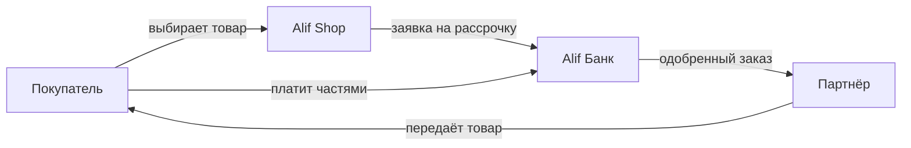
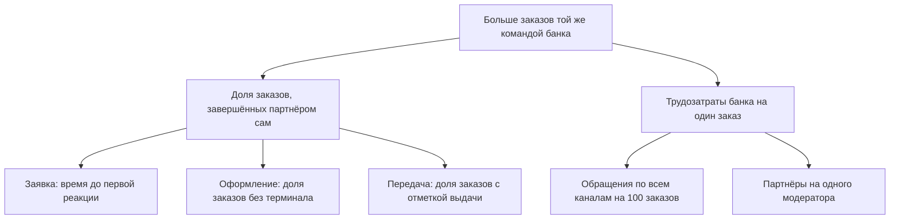

# Alif Partners

Личный кабинет для самостоятельной работы партнёров Alif Shop.

**Роль:** продуктовый дизайнер · **Команда:** UX‑исследователь, продакт‑оунер, продуктовый дизайнер · **Срок:** 4 месяца · **Платформы:** веб и мобильная версия

## Контекст

### Alif Shop, банк и партнёр

Alif крупнейший банк Таджикистана. Он развивает рассрочку через сеть партнёрских магазинов и собственный маркетплейс Alif Shop. Магазины‑партнёры размещают ассортимент, обрабатывают заказы и передают товары покупателям. Банк отвечает за финансовую часть и сопровождение процесса.

**70 000+** активных покупателей в месяц · **500+** партнёрских магазинов · **$1 млрд** объём рынка BNPL (2024)

Банк зарабатывает на рассрочке, а ассортимент, цены и выдачу товара обеспечивает партнёр. От того, как быстро магазин обработает заказ и передаст товар, зависит, сколько заявок станут выданными рассрочками.

Я отвечала за структуру кабинета и пользовательские сценарии, работала с UX‑исследователем и продакт‑оунером, обсуждала технические ограничения с разработчиками. Опыт в колл‑центре и отделе партнёров Alif помог быстро разобраться в операционных процессах, а интервью показали, как они выглядят у пользователей.

## Проблема

### Чтобы выполнить заказ, партнёру требовалось участие банка

Админ‑панель создавалась для работы модераторов. Партнёры пользовались ею частично: о новой заявке узнавали от колл‑центра, оформляли заказ через терминал, а при передаче товара курьеры звонили операторам.

Действия магазина зависели от того, свободны ли сотрудники и работает ли оборудование. Заказ мог задержаться между этапами, а каждый новый партнёр добавлял банку звонки и ручные операции.

> **Продуктовая задача:** дать партнёру самостоятельно пройти операционную часть заказа, от получения заявки до оформления и передачи товара.

**Бизнес‑цель:** обслуживать больше партнёрских заказов без пропорционального роста затрат на сопровождение, сохранив качество данных и контроль операций.

## Исследование

### Где возникала зависимость от банка

Вместе с UX‑исследователем мы провели глубинные интервью с 8 модераторами, 7 ведущими партнёрами и 2 CDO‑менеджерами. Разбирали реальные действия в системе, причины обращений и переходы между кабинетом, терминалами и сотрудниками банка.

| Что выяснили | Что это значит для процесса | Что нужно от решения |
|---|---|---|
| Партнёры ждут звонка о новой заявке | Обработка начинается, только когда позвонит колл‑центр | Уведомление и доступ к заявке у партнёра |
| Терминалов мало, бывают сбои | Оформление задерживается, часть заказов отменяется | Оформление в кабинете с той же бизнес‑логикой |
| Курьеры звонят операторам | В передачу товара включается лишний участник | Сценарий передачи для сотрудников магазина с телефона |
| Существующий товар вводят заново | Повторный ввод отнимает время у модераторов и партнёров | Готовая карточка и отдельное предложение магазина |
| В доставке непонятные статусы и мало данных | Разделом пользуются частично или обходят его | Раздельные самовывоз и доставка, понятный статус заказа |

**Вывод:** стандартные действия с заказом партнёр мог выполнить только через сотрудника банка. Значит, нужно перераспределить операции: партнёр ведёт свой заказ и ассортимент, а банк оставляет за собой обязательные проверки и исключения.

## Гипотеза

**Если партнёр будет получать заявки напрямую и сможет оформлять заказ и передачу товара в кабинете, доля заказов, завершённых без помощи сотрудников банка, вырастет. Ручных вмешательств на заказ станет меньше, а ожидание между этапами сократится.**

Эффект идёт по цепочке:

**Заявка приходит партнёру → он оформляет заказ сам → отмечает передачу товара → банку не нужно вмешиваться.**

Для каталога сформулировали отдельную гипотезу: **если при добавлении существующего товара использовать готовую карточку, партнёр быстрее создаст своё предложение без потери качества данных.**

## Как проверяли

Решения обсуждали с партнёрами по ходу проектирования и проверяли в коридорных тестах. Ключевые сценарии прошли юзабилити‑тест на прототипе. С модераторами отдельно разобрали добавление существующего товара: поиск готовой карточки убрал повторное заполнение основной информации и характеристик, а для новых товаров полный путь остался.

## Метрики

### Северная звезда: доля заказов, которые партнёр завершил сам

Считаю как отношение заказов, оформленных и переданных покупателю без участия сотрудника банка, ко всем заказам, где такой сценарий возможен, включая отменённые. Обязательные кредитные проверки банка в расчёт не входят.

Бизнес‑эффект читаем по двум показателям вместе: доле самостоятельно завершённых заказов и трудозатратам банка на один заказ. Защитные метрики: отмены и ошибки оформления.

## Решения

### 1. Кабинет вокруг задач магазина

Структуру собрали по основным сценариям: магазины, товары, заявки, доставка и отзывы. Для модераторов выделили отдельный раздел проверки и редактирования данных. Партнёр выполняет свои операции, а модератор подключается на этапах контроля.

### 2. Заявка приходит партнёру напрямую

*Вариант A, звонок колл‑центра:* привычно, но обработка ждёт оператора.
*Выбрано B, уведомление в кабинете:* о новых заявках и изменениях заказа партнёр узнаёт сам и сразу открывает заказ. Уведомления о низких остатках помогают не терять заказы из‑за закончившегося товара.
**Влияет на:** время до первой реакции и звонки о заявках.

### 3. Оформление и передача товара в одном процессе

*Вариант A, один раздел доставки со статусами:* так было, и разделом почти не пользовались.
*Выбрано B, раздельные самовывоз и доставка:* оформление из терминала перенесли в кабинет с той же бизнес‑логикой. В карточке видны статус, дата оформления и адрес. Сценарий работает на компьютере и телефоне, поэтому сотрудники магазина и курьеры оформляют выдачу прямо в точке.
**Влияет на:** долю заказов, завершённых партнёром сам, и обращения к операторам. Защитные метрики: ошибки оформления и отмены.

### 4. Готовая карточка вместо повторного заполнения

*Вариант A, заполнять каждый раз:* основная информация, характеристики, медиа и оффер, даже если товар уже продаётся.
*Выбрано B, сначала поиск:* если карточка есть на маркетплейсе, партнёр сразу переходит к медиа и предложению своего магазина. Путь сокращается с четырёх этапов до двух. Для нового товара остаётся полное заполнение.

Партнёры рассказали, что сверяются с конкурентами, когда назначают цену. Поэтому в форму оффера добавили цены аналогичных товаров.

### 5. Помощь, когда сценарий прерывается

Общий чат объединил обращения к модераторам, отделу партнёров и колл‑центру. Если партнёр не может пройти шаг сам, он пишет в одно место, не разыскивая нужный отдел.

## Итог

### Стандартные операции перешли к партнёру, контроль остался у банка

Оформление и передачу заказа объединили в кабинете, доступном сотрудникам магазина и курьерам с компьютера и телефона. Для существующего товара путь создания предложения сократился с четырёх этапов до двух.

Банк передаёт партнёрам стандартные операции и сохраняет за собой контроль и исключения. Это основа для того, чтобы обслуживать больше заказов без пропорционального роста затрат на сопровождение.

## Дальше

- Поэтапно подключать партнёров и отслеживать долю самостоятельных заказов, трудозатраты и качество обработки.
- Массово менять цены, подарки и остатки в каталоге.
- Автоматически скрывать устаревшие товары.
