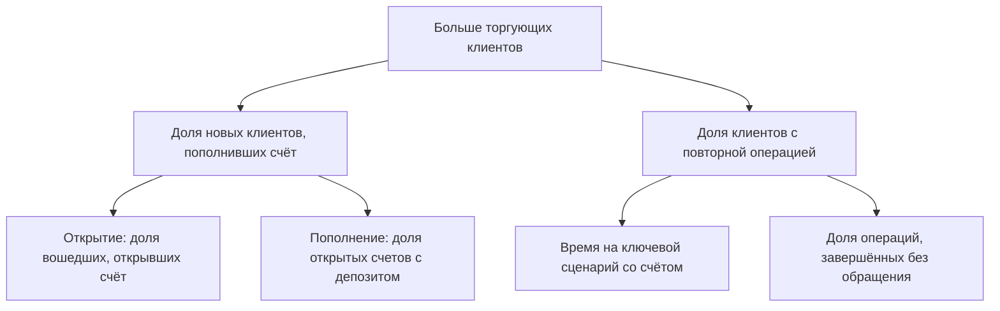

# EAJ Trader

Личный кабинет клиента нового брокера Fibo Group, спроектированный с нуля.

**Роль:** продуктовый дизайнер · **Команда:** продуктовый дизайнер, продакт‑оунер, разработчик · **Срок:** 2 месяца · **Платформа:** веб

## Контекст

### У нового брокера был сайт, но не было кабинета

EAJ Trader новый брокер Fibo Group. Раньше в рамках этого же проекта я сделала для него айдентику и сайт. Следующим шагом стал личный кабинет: место, где клиент открывает торговый счёт, пополняет его, выводит деньги и следит за капиталом.

Брокер зарабатывает, когда клиент торгует. Путь к первой сделке проходит через кабинет: открыть счёт, пополнить его, перейти к торговле. Без кабинета посетители сайта не становятся торгующими клиентами.

Я отвечала за структуру кабинета и логику основных действий. Вместе с продакт‑оунером выбирала, что войдёт в MVP, и обсуждала ограничения с разработчиком.

> **Продуктовая задача:** спроектировать первую версию кабинета, в которой клиент сам проходит путь от входа до пополнения счёта и управляет средствами.

## Исследование

### Для кого первая версия

Заказчик передал предварительное исследование: пять типов пользователей с целями, поведением, болями и фокусом для интерфейса. Я сравнила их задачи, чтобы понять, кто определит MVP.

[Таблица сегментов: Активный трейдер, Скальпер, Свинг‑трейдер, Инвестор‑трейдер, Новичок × Цели, Поведение, Боли, Фокус UX]

| Сегмент | Что ему нужно | Что это значит для MVP |
|---|---|---|
| Активный трейдер | Скорость и минимализм, контроль капитала | Ядро MVP: баланс, счета и операции без лишнего |
| Скальпер | Торговля в 1 клик, низкая задержка | Те же быстрые входы в операции, требования к скорости строже |
| Свинг‑трейдер | Глубокая аналитика портфеля | Нужна аналитика, её можно добавить поверх обзора капитала |
| Инвестор‑трейдер | Портфель и метрики риска | Нужен отдельный модуль риска, это следующий этап |
| Новичок | Обучение, подсказки, ограничения | Нужен отдельный обучающий сценарий, это следующий этап |

**Вывод:** в исследовании заказчика активный трейдер отмечен как основной пользователь платформы. Его потребности, скорость и контроль капитала, частично совпадают со скальпером и свинг‑трейдером. Поэтому MVP строили вокруг активного трейдера: так первая версия закрывает главный сегмент и даёт основу для соседних. Новичку и инвестору нужны отдельные сценарии, их вынесли на следующие этапы.

## Гипотеза

**Если собрать обзор капитала, торговые счета и операции с деньгами в одном кабинете и дать вход в каждую операцию с главной, активный трейдер быстрее дойдёт от входа до пополнения счёта и будет реже теряться между разделами.**

Цепочка:

**Видит капитал → выбирает счёт → пополняет или выводит → возвращается к торговле.**

## Метрики

### Северная звезда: доля новых клиентов, которые пополнили торговый счёт

Считаю как отношение клиентов, открывших и пополнивших торговый счёт, ко всем, кто вошёл в кабинет за период.

Защитные метрики: ошибки и отмены выводов, обращения по операциям.

## Решения

### 1. Главная: капитал и входы в операции на одном экране

Сверху общий баланс, средства в ордерах, замороженные средства и прибыль за 24 часа. Под ними четыре входа: открыть счёт, мои торговые счета, пополнить, вывести. Ниже история сделок и ордеров с кнопкой «Торговать» и обзор активов. Активный трейдер видит состояние капитала и сразу переходит к действию.
**Влияет на:** долю вошедших, открывших счёт, и долю счетов с депозитом.

### 2. Торговые счета: карточки или таблица

*Вариант A, таблица:* номер счёта, валюта, сумма, статус и ROI в строках.
*Выбрано B, карточки:* актив с иконкой и названием, баланс в монете, курс, доходность и статус собраны вокруг одного счёта.

Чтобы проверить выбор, я с помощью нейросети смоделировала шесть задач активного трейдера, скальпера и свинг‑трейдера на обоих вариантах: найти убыточный счёт, найти счёт в ETH, понять, есть ли заблокированный, оценить счёт в долларах, открыть новый, различить два счёта в одном активе.

| Задача | Таблица | Карточки |
|---|---|---|
| Найти убыточный счёт | Нужно читать колонку ROI | Красный процент виден сразу |
| Найти счёт в ETH | Ищет по колонке «Валюта» | Узнаёт по иконке и названию |
| Заблокированный счёт | Красный статус виден сразу | Состояние не показано |
| Счёт в долларах | Видно только у USD‑счетов | Курс есть, суммы в $ нет |
| Открыть счёт | Кнопка справа вверху | Та же кнопка |
| Два счёта в одном активе | Отличаются номером | Номера нет, карточки одинаковые |

**Вывод:** карточки выигрывают там, где трейдер ищет актив и следит за прибылью и убытком: это видно без чтения. Таблица выигрывает в плотности и сравнении, поэтому лучше работает, когда счетов много. Карточке для MVP нужны номер счёта, сумма в долларах и состояние «Заблокирован».

По итогам симуляции я добавила в карточку номер счёта, сумму в долларах, курс своего актива и состояние «Заблокирован» с подсказкой и выходом в поддержку. Таблица осталась вторым видом: переключатель «Карточки / Таблица» стоит над списком.

**Влияет на:** время на ключевой сценарий со счётом.

### 3. Финансирование: все операции с деньгами в одном разделе

Пополнение, вывод и перевод мы с продакт‑оунером собрали в одном разделе, чтобы все основные функции с деньгами были в одном месте. Клиент выбирает депозит, вывод или внутренний перевод между своими счетами. Входы в пополнение и вывод остались и на главной, чтобы не искать их через меню.
**Влияет на:** долю счетов с депозитом и долю клиентов с повторной операцией.

### 4. Претензии и жалобы внутри кабинета

Клиент создаёт обращение, видит список со статусами «Принято», «В процессе», «Решено», «Закрыто», открывает переписку и прикладывает документы. Вопрос по выводу или депозиту решается там же, где прошла операция.
**Влияет на:** долю операций, завершённых без обращения во внешние каналы. Защитная метрика: обращения по операциям.

## Итог

### Кабинет, в котором клиент сам проходит путь до пополнения счёта

Спроектировала веб‑кабинет брокера: главную с обзором капитала, торговые счета, раздел финансирования и обращения в поддержку. Путь от входа до пополнения счёта собран в одном кабинете, а все операции с деньгами в одном разделе.

## Дальше

- Обучающий сценарий для новичков: подсказки и ограничения.
- Модуль риска и аналитика портфеля для инвесторов и свинг‑трейдеров.

