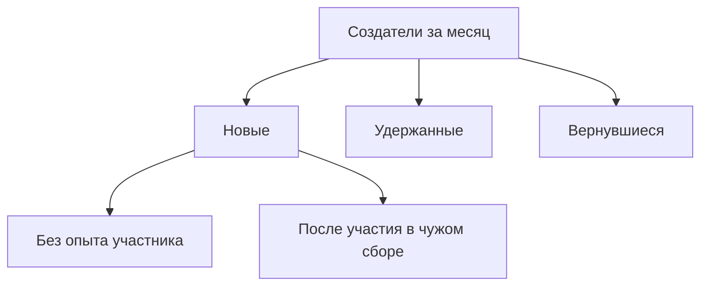

# Разделение ресторанного счёта

Спроектировала путь от оплаченной покупки до последнего перевода: участник видит, из чего сложилась его сумма, а тот, кто оплатил ужин, знает, кто уже вернул деньги.

**Роль:** продуктовый дизайнер
**Пользователи:** тот, кто оплатил счёт, и остальные участники
**Платформа:** iOS

## Что это за продукт

### Сбор в приложении банка, который связывает чек с переводами

Сбор создаётся прямо из оплаченной покупки. Сумму делят поровну, по позициям или вручную, и каждый получает запрос со своей долей. Участник видит, за что платит, а оплативший видит, кто уже перевёл.

## Проблема

### Ресторану заплатили. Между собой ещё нужно рассчитаться

Я заметила знакомую ситуацию: один человек платит за весь ужин, а потом у него начинается вторая работа. Нужно поделить счёт, разослать каждому его сумму, ответить на вопросы и проверить, кто уже перевёл. Я решила разобраться, почему вернуть свои деньги так хлопотно и что здесь может сделать банк.

Участник открывает запрос с одним вопросом: *из чего моя сумма?*

**55%** в последний раз расплачивались в кафе именно так: один платит, остальные переводят ему.

Исследование Т‑Банка, июнь 2025, более 3 000 респондентов. [Публикация](https://rfinance.ru/live/news?id=33349&tid=4)

> **Задача:** связать чек, доли и возвраты в одном месте внутри банка.

**Бизнес-цель:** чтобы функцией разделения пользовалось больше клиентов. Если сервис помог вернуть деньги, следующий общий счёт клиент поделит в нём же. Так растут первые оплаты, повторные сборы и новые создатели из бывших участников.

## Исследование

Я прошла сценарии Т‑Банка, Альфа‑Банка и ВТБ в двух ролях: создавала запрос на одном телефоне и открывала на другом.

| Сервис | Что работает | Где спотыкаешься |
|---|---|---|
| Т‑Банк | Вход из операции, контакты, фото чека, QR | Запрос теряется в истории операций |
| Альфа‑Банк | Вход из операции | Один получатель за раз, связь с покупкой пропадает |
| ВТБ | Своя доля, выбор счёта | Номера вводятся вручную, режимы «Со всех» и «С каждого» путают |
| Splitwise, Tricount | Учёт долей; позиции чека в Splitwise Pro | Отдельный сервис, платежи идут мимо него |

Банки я проходила сама, Splitwise, Tricount и статусы Т‑Банка смотрела по открытым источникам.

**Вывод.** Банки удобно начинают расчёт из операции, но после отправки запрос живёт сам по себе. Нужен сбор: одно место, где связаны чек, доли и оплаты.

Потом с помощью нейросети я смоделировала шесть ситуаций: компании до 15 человек, общие блюда, спорные суммы, друзья из других банков. Так я заранее нашла сложные случаи и собрала карты пути для обеих ролей.

## Гипотеза

**Если получателям запросов по ресторанному счёту показать их позиции и долю в общих блюдах перед оплатой, им будет проще проверить сумму без обращения к создателю. Ожидаю роста конверсии из открытия запроса в успешную оплату и сокращения времени до оплаты.**

Дальше эффект идёт по цепочке:

**Понятная сумма → оплаченный запрос → закрытый сбор → повторное использование.**

## Решения

Для каждого решения было как минимум два варианта. Ниже то, что я выбрала, и почему.

### Сумму можно проверить прямо в запросе

*Вариант A, только итог:* как у большинства банков. Просто, но вопрос «за что столько?» уходит в чат.
*Выбрано B, детализация:* Участник видит свои позиции и долю в общих блюдах и платит на том же экране. Если что-то не так, нажимает «Оспорить» у нужной позиции.

### Сбор создаётся из покупки

*Вариант A, подробный чек всегда:* точнее для участника, но каждое деление становится долгим.
*Выбрано B, позиции по желанию:* Сумма, дата и заведение уже заполнены. Позиции можно добавить по фото чека или вручную, а можно пропустить этот шаг и разделить поровну.

### Чек заполняется сам по фото

*Вариант A, подставлять суммы сразу:* быстрее, но ошибка распознавания тихо уходит в чужие доли.
*Выбрано B, чек как черновик:* Создатель фотографирует чек, и ИИ сам переносит позиции и цены в сбор. Позиции, распознанные неуверенно, подсвечены, их можно поправить. Расхождение с суммой покупки видно сразу, а одно блюдо можно разделить на нескольких человек.

### Видно, кто уже перевёл

*Вариант A, отдельные запросы:* как сейчас у конкурентов. Каждый запрос живёт сам по себе, общего статуса нет.
*Выбрано B, один сбор:* Покупка получает отметку «Разделено» и ведёт к сбору: кто перевёл, сколько осталось и напоминание в одно касание.

### Калькулятор деления

Тот же чек на 8 400 ₽ тремя способами: поровну, по позициям и вручную. Доли пересчитываются сразу, а запросы нельзя отправить, пока сумма не сойдётся с покупкой.

## Дерево метрик

**Главная метрика: доля клиентов, которые создают сборы** (создатели за месяц / MAU приложения). Участников считаю отдельно, чтобы приглашения не выдавать за рост.

Новых создателей делю на тех, кто раньше был участником, и тех, кто не был. Так видно, приводит ли чужой сбор к своему.

## Итог

### Чек, доли и переводы живут в одном сборе

Теперь чек, доли и переводы живут в одном сборе. Участник видит, из чего сложилась его сумма, и сразу платит. Тот, кто оплатил ужин, видит, кто уже перевёл, и не сверяет переводы вручную.

Детализация есть в момент оплаты, а при создании сбора она необязательна, поэтому простой расчёт остаётся коротким. Для банка это повод вернуться: удачный расчёт ведёт к следующему сбору.

## Дальше

- Интервью и тест прототипа, затем A/B‑тест в пилоте.
- Правила для округления, расхождения чека с покупкой и частичной оплаты.
- Межбанковские переводы по СБП для друзей из других банков.
